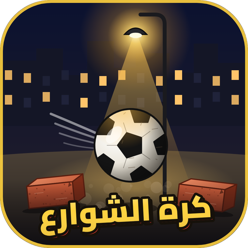

# ⚽ كرة الشوارع

لعبة كورة شوارع 3D بتتلعب في المتصفح على طول، من غير تسطيب.
مفيش ملعب: الماتش بيتلعب في الحارة، أو في حوش واسع، أو في حوش المدرسة، أو على السطح.
الجون طوبتين أو شبشبين، والكعبلة والشد من الهدوم جزء من اللعبة.. بس خلّي بالك من **عدّاد الفضيحة**!

## إزاي تشغّلها
- **أسهل طريقة:** افتح ملف `index.html` بدبل كليك (Chrome أو Edge أو Firefox).
- أو ارفع الريبو على **GitHub Pages** وابعت اللينك لصحابك.
- بتشتغل بالكيبورد، أو بالدراع (Gamepad)، أو على الموبايل بزراير على الشاشة.

## التحكم (لاعب واحد)
| الزرار | الحركة |
|---|---|
| الأسهم | جري |
| `A` | باصة (ومن غير كورة: تطلب الكورة من زميلك) |
| `S` | شوطة (كل ما تدوس أكتر بتبقى أقوى) |
| `D` | **كعبلة** |
| `F` | **شدّ من الهدوم** (فضل داسس) |
| `W` | **كوبري** (تعدّي الكورة من بين رجلين الخصم) |
| `Shift` | سبرنت |
| `Space` | غيّر اللعّيب |
| `Esc` أو `P` | وقّف اللعب |

ولو هتلعبوا اتنين على كيبورد واحد، أو بدراع، الزراير كلها مكتوبة في شاشة **التحكم** جوه اللعبة.

## الأماكن
- **الحارة** (٤×٤): جون بطوبتين، فيها قهوة وبقالة وعربية فول، وبلكونة الحاجة، وتوكتوك بيعدّي.
- **الحوش الواسع** (٥×٥): أرض تراب وعارضتين حديد بشبكة، وكشافات كبيرة بالليل، وخروف متربط في الشجرة.
- **حوش المدرسة** (٥×٥): الجون مرسوم بالطباشير على الحيطة، **والناظر** بيطلع كل شوية. لو شافك بتفاول هيطردك.
- **السطح** (٣×٣): جنب غية الحمام وزينة رمضان. لو الكورة وقعت تحت، حد لازم ينزل يجيبها.

وكل مكان ليه وضع **الضهر** ووضع **بالليل**، وبالليل الكشافات منورة بنور أصفر ضعيف وواحد منهم بيرعش.

## قوانين الحارة
- **عدّاد الفضيحة:** كل كعبلة أو شدّة بتملاه. لو اتملى يحصل واحد من الاتنين: يا **خناقة** يا **أمه تنادي عليه** فيطلع البيت ويلعب فريقه ناقص.
- **البلكونة:** لو الكورة دخلتها، الحاجة هتزعّق وبعدين ترجعها.
- **الإزاز:** شوطة جامدة في الشباك تكسره، والكل يجري.
- **الكوبري:** عدّي الكورة من بين رجلين الخصم، وهيفضل واقف مش فاهم حاجة.
- **البطولة (كأس الحتة):** ٥ ماتشات، تكسب فيها فلوس تشتري بيها من محل عم سيد كورة جلد وكوتشي وفانلات موحدة.

## للمطوّرين
كل حاجة في اللعبة، من رسومات وأصوات وشخصيات، معمولة بالكود. مفيش أي صور أو ملفات صوت من برة.
- الكود في `src/`، والمكتبة المستخدمة [three.js](https://threejs.org).
- `npm install` وبعدين `npm run build`، وده بيطلّع `game.js` و`fonts.css`.
- الشخصيات ليها هيكل بمفاصل (وسط ← فخد ← ركبة ← كاحل، وصدر ← كتف ← كوع)، والحركة محسوبة إجرائيًا في `src/actors/character.js`.
